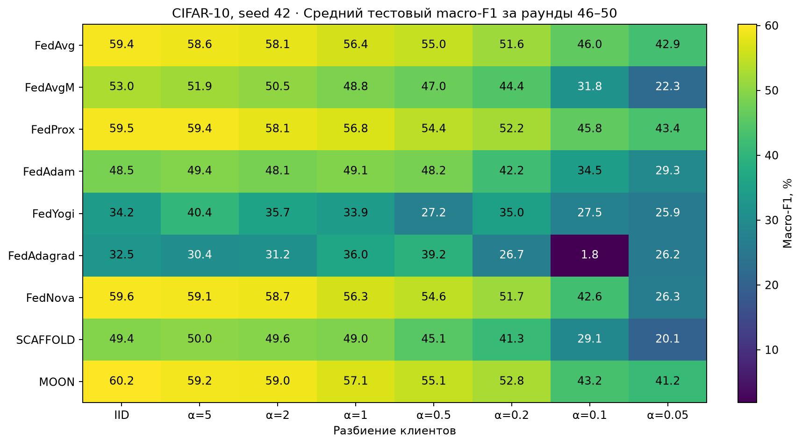
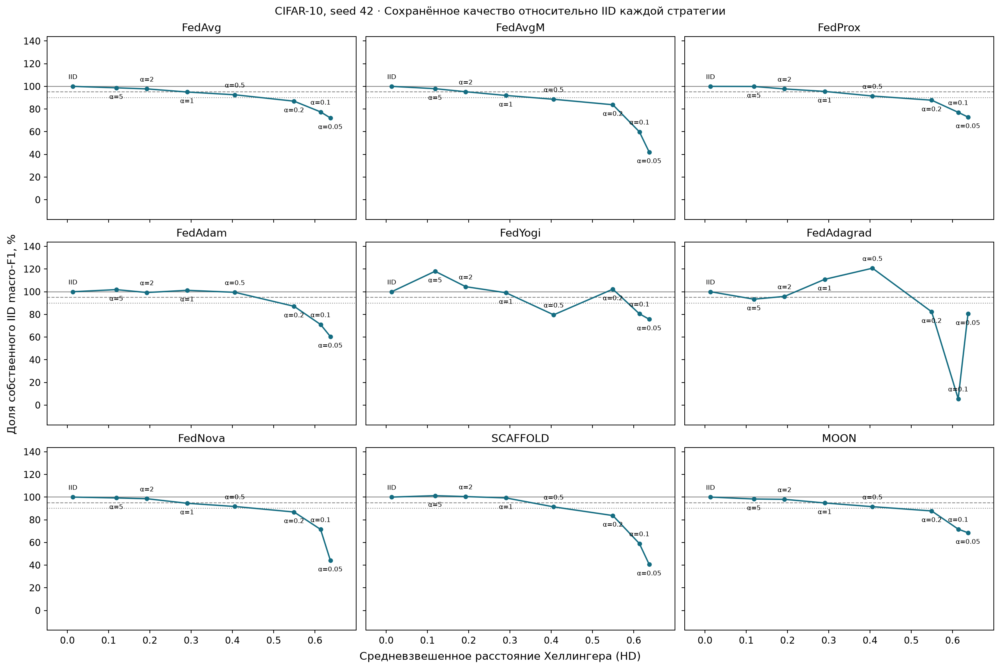
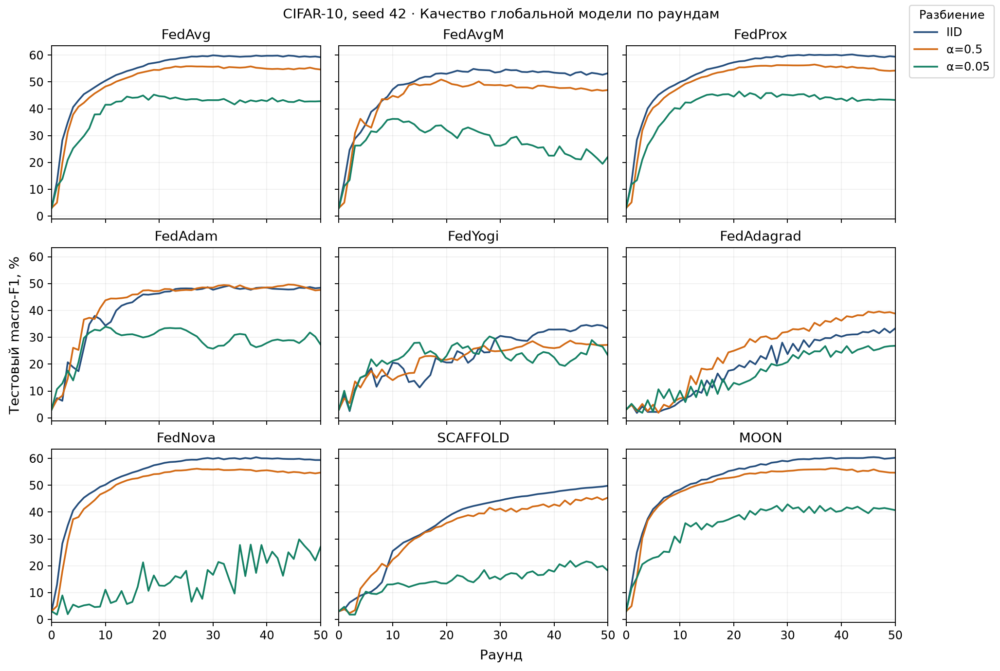

# Эксперимент 4. Девять стратегий на восьми разбиениях CIFAR-10

*Выполнен 22–23.11.2026 на Mac M1 (CPU). Один seed = 42. Общий контекст и состояние остальных экспериментов см. в `Состояние_экспериментов.md`.*

## 1. Что сделано

Провели 72 запуска обучения на CIFAR-10: 9 стратегий × 8 разбиений (IID и Дирихле с α = 5, 2, 1, 0.5, 0.2, 0.1, 0.05), по 50 раундов. Для каждой стратегии точкой отсчёта служит её собственный результат на IID. Все 72 запуска завершились без ошибок.

| Параметр | Значение |
|---|---|
| Датасет | CIFAR-10, исходные обучающая и тестовая выборки (тест — 10 000 изображений) |
| Стратегии | FedAvg, FedAvgM, FedProx, FedAdam, FedYogi, FedAdagrad, FedNova, SCAFFOLD, MOON |
| Обучение | 10 клиентов, все участвуют в каждом раунде; 50 раундов; 1 локальная эпоха; batch 32; клиентский lr 0.01 |
| Остальное | CNN проекта, `class-weighting = none`, `dirichlet-min-partition-size = 50`, `validation-ratio = 0.2`. Параметры стратегий — значения по умолчанию из `pyproject.toml`, одинаковые во всех сценариях: `local-momentum = 0.9`, `proximal-mu = 0.01`, `server-momentum = 0.9`, `fedopt-eta = 0.1`, `fedopt-tau = 0.001`, `moon-mu = 1.0` |
| Конфигурация | `quickstart-pytorch/configs/cifar10_sweep_seed42_cpu.toml` |
| Время | ≈ 10 мин на запуск (MOON ≈ 14 мин), ≈ 12 ч на серию |

**Отличие от исходного задания.** Задание предполагало `configs/cifar10_sweep_seed42.toml` и каталог `results/cifar10-sweep-seed42/`. Эта конфигурация требует `client-num-gpus = 0.5`, а на Mac нет CUDA. Поэтому создана CPU-копия, которая отличается только отсутствием `client-num-gpus`, идентификатором серии и каталогом результатов `results/cifar10-sweep-seed42-cpu/`. Так серия не пересекается с возможной GPU-серией на другой машине.

**Порядок.** Сначала прошли 9 IID-запусков, чтобы проверить, что ни одна стратегия не застревает на уровне угадывания за 50 раундов. После проверки запустили остальные 63; IID-запуски бенчмарк использовал повторно.

**Показатель качества.** `Q` — средний тестовый macro-F1 глобальной модели за раунды 46–50 (строки `centralized_test`). Изменение относительно IID: `100 × (Q − Q_IID)` п.п. Сохранённое качество: `100 × Q / Q_IID` %, где `Q_IID` — для той же стратегии.

## 2. Измеренная неоднородность разбиений

Измерено скриптом `analyze_heterogeneity.py` на тех же данных и с тем же seed, что и обучение. HD взвешен по числу изображений клиента до выделения локальной валидации.

| Разбиение | HD | Доля отсутствующих классов | Эффективное число клиентов | max/min размеров клиентов |
|---|---:|---:|---:|---:|
| IID | 0,013 | 0,00 | 10,0 | 1,0 |
| α = 5 | 0,119 | 0,00 | 9,8 | 1,6 |
| α = 2 | 0,193 | 0,00 | 9,5 | 2,1 |
| α = 1 | 0,290 | 0,00 | 9,4 | 2,3 |
| α = 0.5 | 0,406 | 0,01 | 8,5 | 5,0 |
| α = 0.2 | 0,549 | 0,21 | 7,7 | 8,2 |
| α = 0.1 | 0,614 | 0,38 | 6,5 | 27,8 |
| α = 0.05 | 0,637 | 0,49 | 4,8 | 40,1 |

HD растёт монотонно, но на крутом участке точки лежат плотно: α = 0.1 и 0.05 отличаются по HD всего на 0,023, зато сильно — по доле отсутствующих классов и перекосу размеров.

## 3. Абсолютное качество

**Q, %** (жирным — лучший результат в сценарии):

| Стратегия | IID | α=5 | α=2 | α=1 | α=0.5 | α=0.2 | α=0.1 | α=0.05 |
|---|---:|---:|---:|---:|---:|---:|---:|---:|
| FedAvg | 59,38 | 58,61 | 58,06 | 56,42 | 54,97 | 51,63 | **46,00** | 42,85 |
| FedAvgM | 53,02 | 51,93 | 50,50 | 48,76 | 46,97 | 44,42 | 31,77 | 22,31 |
| FedProx | 59,48 | **59,41** | 58,13 | 56,82 | 54,40 | 52,22 | 45,85 | **43,38** |
| FedAdam | 48,46 | 49,36 | 48,12 | 49,06 | 48,21 | 42,23 | 34,45 | 29,31 |
| FedYogi | 34,19 | 40,36 | 35,71 | 33,89 | 27,22 | 34,96 | 27,54 | 25,90 |
| FedAdagrad | 32,49 | 30,35 | 31,15 | 36,04 | 39,24 | 26,74 | 1,82 | 26,15 |
| FedNova | 59,58 | 59,14 | 58,72 | 56,33 | 54,63 | 51,74 | 42,61 | 26,34 |
| SCAFFOLD | 49,38 | 49,99 | 49,60 | 49,02 | 45,12 | 41,34 | 29,14 | 20,08 |
| MOON | **60,20** | 59,18 | **59,00** | **57,07** | **55,11** | **52,84** | 43,20 | 41,25 |

Тест CIFAR-10 сбалансирован, поэтому финальные accuracy и balanced accuracy совпадают; они и финальный loss есть в `sweep_summary.csv`.



## 4. Качество относительно собственного IID

**Сохранённое качество, %:**

| Стратегия | α=5 | α=2 | α=1 | α=0.5 | α=0.2 | α=0.1 | α=0.05 |
|---|---:|---:|---:|---:|---:|---:|---:|
| FedAvg | 98,7 | 97,8 | 95,0 | 92,6 | 86,9 | 77,5 | 72,2 |
| FedAvgM | 97,9 | 95,2 | 92,0 | 88,6 | 83,8 | 59,9 | 42,1 |
| FedProx | 99,9 | 97,7 | 95,5 | 91,5 | 87,8 | 77,1 | 72,9 |
| FedAdam | 101,9 | 99,3 | 101,3 | 99,5 | 87,1 | 71,1 | 60,5 |
| FedYogi | 118,0 | 104,4 | 99,1 | 79,6 | 102,2 | 80,5 | 75,7 |
| FedAdagrad | 93,4 | 95,9 | 110,9 | 120,8 | 82,3 | 5,6 | 80,5 |
| FedNova | 99,3 | 98,6 | 94,5 | 91,7 | 86,8 | 71,5 | 44,2 |
| SCAFFOLD | 101,2 | 100,4 | 99,3 | 91,4 | 83,7 | 59,0 | 40,7 |
| MOON | 98,3 | 98,0 | 94,8 | 91,5 | 87,8 | 71,8 | 68,5 |

**Первое разбиение в порядке роста HD, где сохранённое качество опустилось до 95 % и 90 %:**

| Стратегия | Q на IID | ≤ 95 % | ≤ 90 % |
|---|---:|---|---|
| FedAvg | 59,38 % | α=0.5, HD 0,406 (92,6 %) | α=0.2, HD 0,549 (86,9 %) |
| FedAvgM | 53,02 % | α=1, HD 0,290 (92,0 %) | α=0.5, HD 0,406 (88,6 %) |
| FedProx | 59,48 % | α=0.5, HD 0,406 (91,5 %) | α=0.2, HD 0,549 (87,8 %) |
| FedAdam | 48,46 % | α=0.2, HD 0,549 (87,1 %) | α=0.2, HD 0,549 (87,1 %) |
| FedYogi | 34,19 % | α=0.5, HD 0,406 (79,6 %), затем снова выше при α=0.2 (102,2 %) | то же |
| FedAdagrad | 32,49 % | α=5, HD 0,119 (93,4 %), затем снова выше при α=2 (95,9 %) | α=0.2, HD 0,549 (82,3 %) |
| FedNova | 59,58 % | α=1, HD 0,290 (94,5 %) | α=0.2, HD 0,549 (86,8 %) |
| SCAFFOLD | 49,38 % | α=0.5, HD 0,406 (91,4 %) | α=0.2, HD 0,549 (83,7 %) |
| MOON | 60,20 % | α=1, HD 0,290 (94,8 %) | α=0.2, HD 0,549 (87,8 %) |

У FedAvg при α = 1 сохранённое качество равно 95,0 % после округления, но чуть выше порога, поэтому пересечение 95 % отнесено к α = 0.5.



## 5. Ход обучения



По кривым для IID, α = 0.5 и α = 0.05:

- FedAvg, FedProx, FedNova и MOON выходят на плато к 25–40-му раунду во всех трёх сценариях. Неоднородность снижает уровень плато, а не только замедляет старт.
- SCAFFOLD на IID и α = 0.5 растёт до 50-го раунда и плато не достигает. На 3-м раунде у него было 7,6 % — так объясняется вырождение в пилоте.
- FedAvgM при α = 0.05 достигает пика около 36 % к 10-му раунду, а затем деградирует до ≈ 22 %.
- FedNova при α = 0.05 колеблется между раундами от 10 до 30 %, поэтому её `Q` в этом сценарии зашумлён.
- FedYogi и FedAdagrad растут медленно и ступенчато во всех сценариях.

## 6. Выводы

1. **Лидеры по абсолютному macro-F1 — FedAvg, FedProx и MOON.** До α = 0.2 они, вместе с FedNova, отличаются не больше чем на 1,5 п.п.; MOON формально первый в 5 сценариях из 8, но на одном seed эта разница не значима. При крайней неоднородности (α = 0.05) лучше всех FedProx, FedAvg и MOON (41–43 %).
2. **Деградация нелинейная, с порогом.** До HD ≈ 0,3 сильные стратегии теряют ≤ 5 %, при HD 0,41–0,55 — 8–13 %, после HD 0,55 — резкое падение: при α = 0.05 FedAvg, FedProx и MOON теряют 27–32 %, а FedAvgM, FedNova и SCAFFOLD — 56–59 %. Порог 95 % лидеры пересекают при HD 0,29–0,41, порог 90 % — при HD 0,55.
3. **Методы коррекции дрейфа не сдвинули порог вправо.** FedProx ведёт себя как FedAvg, MOON — близко к нему, SCAFFOLD теряет качество быстрее FedAvg. Гипотеза H1 из плана в части сдвига порога на этом seed не подтверждается.
4. **Слабое обучение уже на IID** показали FedAdagrad (32,5 %), FedYogi (34,2 %), FedAdam (48,5 %), SCAFFOLD (49,4 %) и FedAvgM (53,0 %) — при 59–60 % у лидеров. Для них сохранённое качество надо читать вместе с абсолютным: даже 100 % означает слабую модель.
5. **FedYogi и FedAdagrad не дают интерпретируемых кривых.** Сохранённое качество скачет от 80 до 121 % без связи с неоднородностью. FedAdagrad при α = 0.1 выродился в константный классификатор: со 2-го раунда все 10 000 тестовых изображений отнесены к `airplane`, macro-F1 1,82 % (матрица `confusion_matrices/centralized_round_050.csv` этого запуска).

## 7. Ограничения и следующие шаги

- **Один seed.** Он задаёт и разбиение, и инициализацию; разброс и воспроизводимость порогов неизвестны. Следующий шаг — seed 43 и 44 для тех же сценариев.
- **Гиперпараметры не подобраны.** Результаты FedYogi, FedAdagrad, FedAdam, FedAvgM и SCAFFOLD, вероятно, отражают значения по умолчанию, а не свойства алгоритмов. Гипотезы: `fedopt-eta = 0.1` слишком велик для FedOpt; `server-momentum = 0.9` поверх локального momentum 0.9 вредит FedAvgM; SCAFFOLD обучается локально без momentum (`pytorchexample/local_training.py:190`). Для честной настройки сначала нужна доработка 10.2 плана — параметры отдельных стратегий в TOML бенчмарка.
- **Мало точек на крутом участке.** Между HD 0,55 и 0,64 только α = 0.1 и 0.05. Для оценки порога нужны промежуточные α (например, 0.15 и 0.07) или другие генераторы разбиений.
- **Разница с IID включает два эффекта** — смену долей классов и перекос размеров клиентов. Разделить их помогут оси L′ и Q плана (доработка 10.3).
- Выводы относятся к малой CNN проекта и 50 раундам.

## 8. Файлы и воспроизведение

В Git сохранены сводки из `quickstart-pytorch/results/cifar10-sweep-seed42-cpu/`: `summary.md` (автоматический отчёт), `sweep_summary.csv` (72 строки, одна на запуск), `aggregation_benchmark.csv` (стандартная сводка), `heterogeneity_metrics.csv`, `benchmark_state.json` и графики `plots/{quality,retention,learning}.{png,pdf}`. Каталоги отдельных запусков (`runs/`, ≈ 1,2 ГБ: `round_metrics.csv`, матрицы ошибок, логи) и артефакты разбиений (`heterogeneity/`) остаются только локально на Mac.

Команды из `quickstart-pytorch/` (на Mac вместо `python` использовать `venv/bin/python`: в zsh `python` — алиас на системный Python):

```bash
source venv/bin/activate
out=results/cifar10-sweep-seed42-cpu
config=configs/cifar10_sweep_seed42_cpu.toml
bash scripts/measure_cifar10_sweep.sh "$out"
python scripts/run_benchmark.py --config "$config" --dry-run
python scripts/run_benchmark.py --config "$config"
python scripts/collect_benchmark.py --state "$out/benchmark_state.json" --output "$out/aggregation_benchmark.csv"
python scripts/analyze_cifar10_sweep.py --config "$config"   # таблица, графики и summary.md без обучения
```

Проверки: в `sweep_summary.csv` 72 уникальные строки, все со статусом `completed`; у каждого запуска есть раунды 0–50 и участие всех 10 клиентов в каждом раунде; у IID изменение 0 п.п. и сохранённое качество 100 %; пример `0.40 → 0.36` даёт −4 п.п. и 90 %; повторный dry-run показывает 72 `REUSED`; 163 теста проходят.
